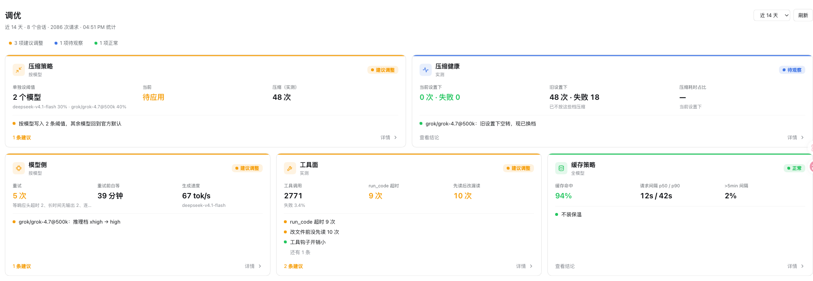
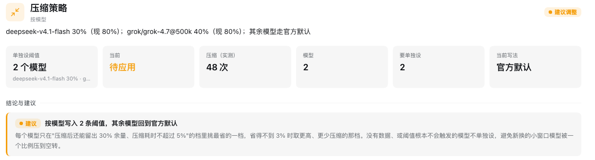
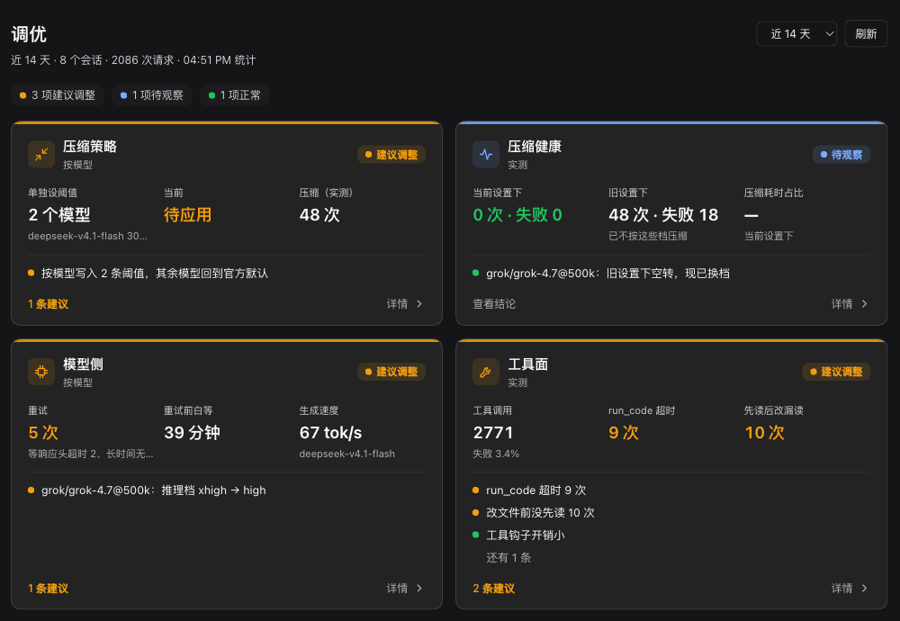

# dsh-tuner

English · [中文](README.zh.md)

**Tuning advice for DeepSeek Harness (DSH) based on your own sessions, module by module, with one-click compaction thresholds.**

There is no single best configuration: long sessions and quick questions, a 500k-window model and a 1M-window model each have their own sweet spot. dsh-tuner reads only the sessions on your machine and answers three questions per module: how things are now, whether to change anything, and what to change it to.

> The panel UI is in Chinese.



## Modules

| Module | Question it answers | Outcome |
|---|---|---|
| Compaction policy | At what ratio should each model compact? Will it compact again right after (a "treadmill")? | **One click** writes `compaction-basic.modelPolicies` into the active agent preset |
| Compaction health | How did real compactions go: failures and causes, time spent? Runs are judged against the threshold in force at the time, so fixed problems stay separate from current ones | Config snippet |
| Cache | Cache hit ratio and request gaps; is a cache keep-warm worth it? | Verdict |
| Model side | Retries by cause, reasoning effort, generation speed per model; are idle timeouts concentrated at the highest effort? | Advice (effort is set in the model picker) |
| Tools | Calls, failure causes and output size per tool; hook overhead | Copyable AGENTS.md sentences |

The overview fits every module on one screen; click a card for the details: conclusions, data tables, replay breakdown and definitions. Follows the app's light and dark themes.



<details><summary>Dark theme</summary>



</details>

## Install

Verified on DSH 0.2.2-rc.1 (the desktop app's `desktop` profile and `dsh web`).

```sh
dsh plugin --profile <profile> add github:doctorllll/dsh-tuner#v0.5.2
```

The desktop app's `desktop` profile only accepts the CLI bundled with the app (a `dsh` on your PATH refuses with `managed exclusively by the Electron application`). On macOS:

```sh
"/Applications/DeepSeek Harness.app/Contents/Resources/runtime/cli/bin/dsh" \
  plugin --profile desktop add github:doctorllll/dsh-tuner#v0.5.2
```

Quit the app before installing and reopen it afterwards; in `dsh web`, reload the page. A 「调优 v0.5」 (Tuner) entry appears in the sidebar.

Uninstall with `dsh plugin --profile <profile> remove dsh-tuner`. Thresholds already written into a preset stay there; click 「恢复 preset 默认」 (restore preset defaults) in the panel first if you want the defaults back.

## Use

1. Open 「调优」 in the sidebar and pick a window (last 7 / 14 / 30 days).
2. Scan the overview: orange = worth changing, blue = waiting for data, green = fine.
3. Open the compaction policy card and check each model's replay table; click 「应用按模型建议」 (apply per-model advice) if you agree.
4. Written settings apply to **new sessions only**; run `/compact` or reopen sessions that are already open.
5. Restore the preset defaults at any time.

Without the UI, the `/tuner` slash command prints the same report as text.

## What it changes

- **Read-only by default**: it reads this profile's sessions through DSH's session query service and computes everything locally. No model calls, no network, nothing uploaded.
- **Writes only when you click apply**: one row, `compaction-basic` of the default agent preset, in the profile's `cordis.patch.yml`. It reads the value back and rolls back if it did not land. Your other changes to the preset are kept.
- **At startup**: if a preset override names rows the running DSH no longer ships (common after an upgrade, and fatal for that mode's sessions), it rebuilds that override on the new defaults, keeping the rows you changed, and the panel says which rows were dropped or added.
- **Never touches**: model choice, reasoning effort, AGENTS.md, hook configuration. Those get advice and copyable text only.

## Limitations

- The replay is an estimate, not a re-run: changes in summary quality are not modelled, and the post-compaction floor is a measured median, so an unusually large turn may land higher.
- Subagent sessions are excluded; forks are included (shared history counted once); sessions with fewer than 3 requests are skipped.
- A preset override is a complete config (DSH semantics): when upstream only changes the defaults of existing rows, the override does not follow.
- A cache keep-warm is not something this plugin provides; it only tells you whether one is worth installing.

## How it works

How the advice is computed and why preset overrides get rebuilt: [docs/DESIGN.zh.md](docs/DESIGN.zh.md) (Chinese). Release history: [CHANGELOG.md](CHANGELOG.md).

## Feedback

Please open an [issue](https://github.com/doctorllll/dsh-tuner/issues).

## License

MIT, see [LICENSE](LICENSE).
