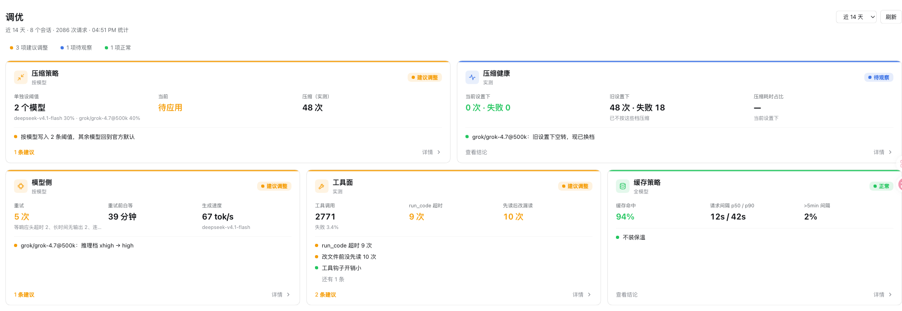
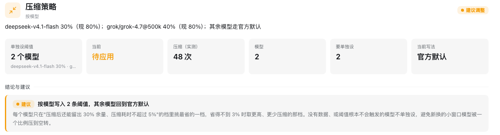
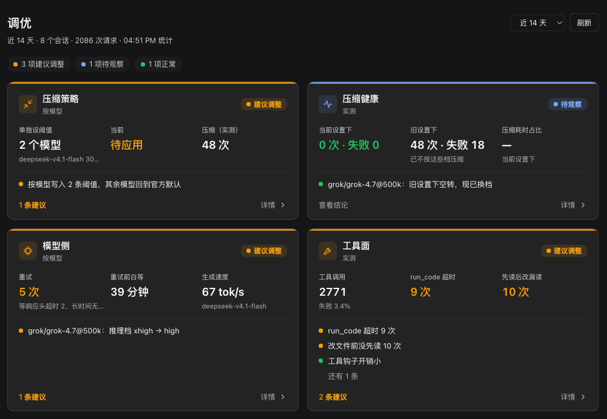

# dsh-tuner · 调优

[English](README.md) · 中文

**按你自己的真实用量，给 DeepSeek Harness（DSH）逐项调优建议；压缩阈值可以一键写入。**

没有一份对所有人都最好的配置：长会话和短问答、500k 窗口和 1M 窗口的模型，各有各的最优点。dsh-tuner 只看你本机的会话记录，按模块回答三件事：现在怎么样、要不要改、改成什么。



## 五个模块

| 模块 | 回答的问题 | 怎么落地 |
|---|---|---|
| 压缩策略 | 每个模型在多大比例触发压缩最省？压完会不会马上又压（"跑步机"）？ | **一键写入**当前 agent preset 的 `compaction-basic.modelPolicies` |
| 压缩健康 | 真实发生的压缩：失败几次、为什么、耗时占多少？按当时生效的阈值分档，旧问题和新问题分开 | 给配置片段 |
| 缓存策略 | 缓存命中率、请求间隔；值不值得装"缓存保温" | 给结论 |
| 模型侧 | 每个模型的重试原因、推理档、生成速度；长时间无输出是不是集中在最高推理档 | 给建议（推理档在模型选择里改） |
| 工具面 | 每个工具的调用、失败原因、输出大小；钩子开销 | 给可复制的 AGENTS.md 句子 |

总览一屏放下全部模块，点卡片进详情：结论与建议、数据表、回放明细、口径。深色 / 浅色主题都跟随 App。



<details><summary>深色主题</summary>



</details>

## 安装

已验证：DSH 0.2.2-rc.1（桌面 App 的 `desktop` profile、网页版 `dsh web`）。

```sh
dsh plugin --profile <profile 名> add github:doctorllll/dsh-tuner#v0.5.2
```

桌面 App 的 `desktop` profile 只认 App 自带的 CLI（PATH 里的 `dsh` 会报 `managed exclusively by the Electron application`）。macOS：

```sh
"/Applications/DeepSeek Harness.app/Contents/Resources/runtime/cli/bin/dsh" \
  plugin --profile desktop add github:doctorllll/dsh-tuner#v0.5.2
```

装前先退出 App，装完重开；网页版刷新页面。侧栏出现「调优 v0.5」。

卸载：`dsh plugin --profile <profile 名> remove dsh-tuner`。已经写进 preset 的压缩参数不会随卸载消失，想回到默认先在面板里点「恢复 preset 默认」。

## 怎么用

1. 打开侧栏「调优」，右上角选统计窗口（近 7 / 14 / 30 天）。
2. 先看总览：橙色"建议调整"、蓝色"待观察"、绿色"正常"。
3. 点进「压缩策略」，看每个模型的回放表；同意就点「应用按模型建议」。
4. 写入后**只对新会话生效**；已经开着的会话用 `/compact` 或重开。
5. 不满意随时「恢复 preset 默认」。

没有界面时，斜杠命令 `/tuner` 输出同一份报告的文本版。

## 它会改什么

- **平时只读**：通过 DSH 的会话查询接口读本 profile 的会话记录，在本机计算。不调模型、不联网、不上传任何东西。
- **你点「应用」时才写**：只写当前 profile 的 `cordis.patch.yml` 里默认 agent preset 的 `compaction-basic` 一行；写完回读校验，对不上自动回滚。preset 里你别的改动原样保留。
- **启动时**：如果 preset 覆盖点名了当前 DSH 已经不提供的行（DSH 升级后常见，不处理会导致该模式的会话起不来），按新版默认重建这份覆盖，你改过的行保留，面板顶部写明删了 / 加了哪些行。
- **从不改**：模型选择、推理档、AGENTS.md、钩子配置。这些只给建议和可复制的文本。

## 限制

- 回放是估算，不是复现：摘要质量的变化不在估算内；"压缩后保底"取实测中位数，个别大轮次压完可能更大。
- 子代理会话不计；fork 会话计入（共享的历史只算一次）；少于 3 条请求的会话不计。
- preset 覆盖是整份 config（DSH 的语义）：上游只调整了已有行的默认值时，不会自动跟进。
- "缓存保温"不是本插件提供的能力，它只回答值不值得装。

## 原理

建议怎么算出来的、preset 覆盖为什么要重建，见 [docs/DESIGN.zh.md](docs/DESIGN.zh.md)。版本变化见 [CHANGELOG.md](CHANGELOG.md)。

## 反馈

问题和建议请提 [Issue](https://github.com/doctorllll/dsh-tuner/issues)。

## License

MIT，见 [LICENSE](LICENSE)。
